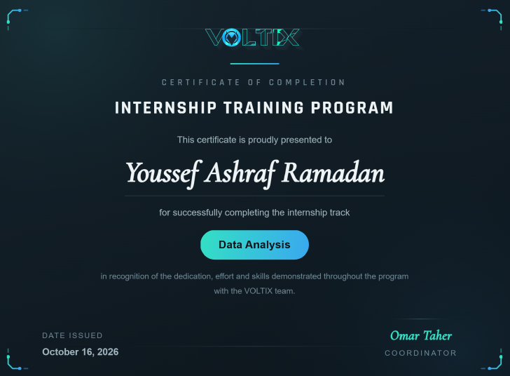

# Voltix Internship — Data Analysis Portfolio

A collection of **12 practical tasks** completed during my **Voltix Internship**, showcasing my learning and hands-on experience in data analysis, data cleaning, exploratory data analysis (EDA), Excel reporting, Python, SQL-related analytical workflows, and interactive dashboard development.

> **Certificate image:** The README expects the certificate image to be named `Voltix_Internship_Certificate.png` and placed in the repository's root folder. Rename your certificate PNG to this name and place it beside this README so it appears on GitHub.

## About This Repository

This repository brings the internship tasks together in one place. Each task is stored in its own folder and includes the relevant project files, such as notebooks, datasets, dashboards, visualizations, and a task-specific README where available.

## Tools & Skills

- **Python:** data cleaning, data manipulation, exploratory data analysis, and visualization
- **Pandas & NumPy:** data preparation and analysis
- **Matplotlib & Seaborn:** exploratory visualizations
- **Microsoft Excel:** formulas, PivotTables, conditional formatting, and dashboards
- **Power BI:** interactive dashboards, KPIs, data modeling, and reporting
- **Power Query:** data transformation and preparation
- **DAX:** measures and calculated metrics
- **Streamlit & Plotly:** interactive Python dashboard development
- **Analytical skills:** data quality checks, feature engineering, trend analysis, insight generation, and communicating findings

## Internship Tasks

| Task | Project | Main Tools | Project Folder |
|---:|---|---|---|
| 01 | Basic Sales Data Analysis | Python, Pandas, NumPy, Matplotlib | [`Task_1_Sales_Analysis_Python`](Task_1_Sales_Analysis_Python/) |
| 02 | Sales Performance Dashboard | Power BI, Power Query, DAX | [`Task_2_Sales_Performance`](Task_2_Sales_Performance/) |
| 03 | Employee Attrition & Performance Analysis | Python, Pandas, Power BI | [`Task_3_Employee_Analysis`](Task_3_Employee_Analysis/) |
| 04 | Excel Sales Tasks | Excel formulas, Conditional Formatting, PivotTables, XLOOKUP | [`Task_4_Excel_Tasks`](Task_4_Excel_Tasks/) |
| 05 | Titanic Data Cleaning & Interactive Analysis | Python, Pandas, Plotly, Streamlit | [`Task_5_titanic_analysis`](Task_5_titanic_analysis/) |
| 06 | Weather Data Analysis & Dashboard | Power BI, Power Query, DAX | [`Task_6_Weather_Data`](Task_6_Weather_Data/) |
| 07 | Hospital Analytics Dashboard | Excel, Power BI, Power Query, DAX | [`Task_7_Hospital_Analytics`](Task_7_Hospital_Analytics/) |
| 08 | Healthcare No-Show Analysis | Excel, PivotTables, PivotCharts, Slicers | [`Task_8_Healthcare_Analysis`](Task_8_Healthcare_Analysis/) |
| 09 | Customer Data Analysis | Python, Pandas, Power BI, DAX | [`Task_9_Customer_Analysis`](Task_9_Customer_Analysis/) |
| 10 | Movie Analytics Dashboard | Power BI, Power Query, DAX | [`Task_10_Movies_Analysis`](Task_10_Movies_Analysis/) |
| 11 | Video Game Industry Analysis | Python, Pandas, NumPy, Power BI | [`Task_11_Video_Game_Industry_Analysis`](Task_11_Video_Game_Industry_Analysis/) |
| 12 | New York City Airbnb Market Analysis | Python, Pandas, Power BI | [`Task_12_New_York_City`](Task_12_New_York_City/) |

## Project Highlights

- Cleaned and validated datasets containing missing, duplicate, inconsistent, or invalid values.
- Used exploratory analysis to investigate trends, distributions, performance, and relationships in data.
- Built dashboards and reports to communicate KPIs and findings clearly.
- Practiced turning raw datasets into structured analysis and business-oriented insights.
- Documented individual projects and their methods in task-level README files.

## How to Explore the Repository

1. Open any task folder from the table above.
2. Read the task's `README.md` for its objective, workflow, findings, and file details.
3. Open the included notebook to review the Python analysis, where applicable.
4. Open `.pbix` files with **Power BI Desktop** and Excel workbooks with **Microsoft Excel**.
5. Keep each task's datasets and image files in their expected locations so notebooks, dashboards, and README image previews can work correctly.

Some dashboards may require their source dataset paths to be updated after downloading or cloning the repository.

## About Me

**Youssef Ashraf Ramadan**  
Computer and Information Technology Student — Egyptian E-Learning University (EELU)  
Aspiring Data Analyst | Python | Excel | Power BI | Data Analysis

## Acknowledgment

These projects were completed as part of my **Voltix Internship**. The experience helped me strengthen practical data analysis skills, work through data-quality challenges, build reports and dashboards, and communicate findings from data.

---

*Thanks for visiting my Voltix Internship portfolio!*
