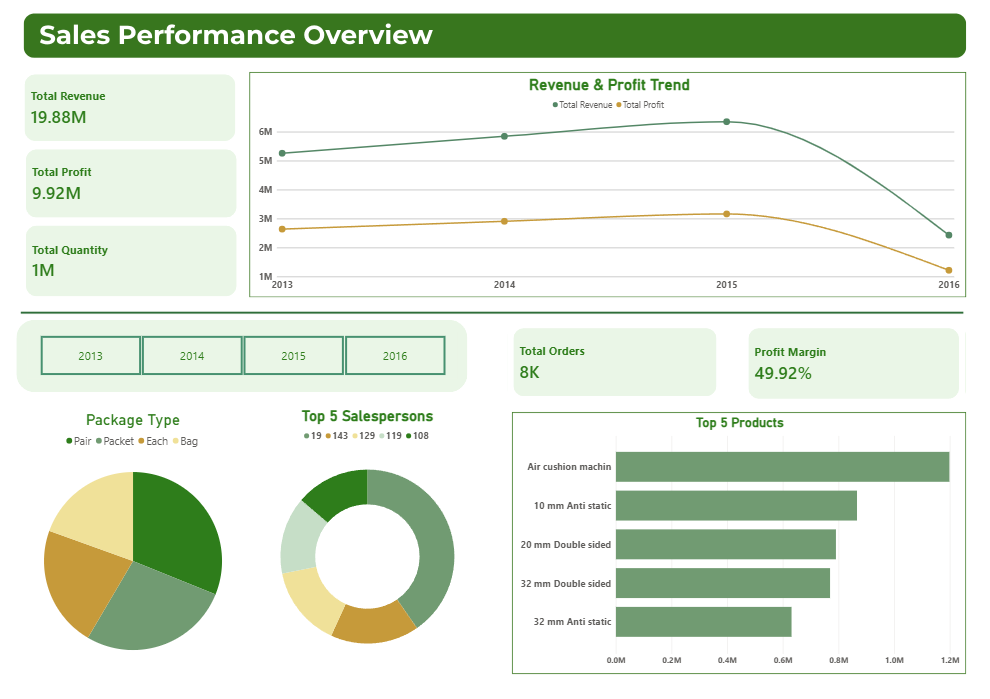

# 📊 Sales Performance Dashboard — Voltix Internship

## 📌 Project Overview
This project analyzes sales performance data and presents the key findings in an interactive **Power BI dashboard**. It was completed as **Task 2 — Sales Performance** during my internship at **Voltix**.

The goal was to transform raw sales data into a clear, management-friendly view of revenue, profit, order volume, product performance, and sales trends.

## 🛠️ Tools & Technologies
- **Power BI** — dashboard development and data visualization
- **Power Query** — data cleaning and preparation
- **DAX** — measures and KPI calculations
- **CSV** — source sales dataset

## 🔍 Workflow
1. **Data Cleaning & Validation:** Reviewed missing values and date-format inconsistencies.
2. **Data Preparation:** Cleaned and transformed the source data using Power Query.
3. **Data Modeling & Measures:** Created DAX measures for key performance indicators.
4. **Dashboard Design:** Built a clean, interactive dashboard to highlight business performance and trends.
5. **Insight Generation:** Used the dashboard to identify top-performing products and order patterns.

## 📈 Dashboard Highlights
- **Total Revenue:** 19.88M
- **Total Profit:** 9.92M
- **Total Quantity:** 1M
- **Total Orders:** 8K
- **Profit Margin:** 49.92%
- **Revenue & Profit Trend:** Yearly comparison from 2013 to 2016
- **Top 5 Products:** Ranked by revenue
- **Sales by Package Type:** Breakdown by package category
- **Top 5 Salespersons:** Comparison of the top salesperson IDs
- **Year Filter:** Filter dashboard results by year

## 💡 Key Business Insights
- The business generated approximately **19.88M in revenue** and **9.92M in profit**.
- The reported profit margin is approximately **49.92%**.
- **Air cushion machine** is the leading product by revenue in the dashboard.
- The dashboard enables year-by-year comparison of revenue and profit.
- Package type and salesperson visuals provide additional views of sales performance.

> Metrics and insights above reflect the values displayed in the dashboard and may depend on the selected filters.

## 🖼️ Dashboard Preview

## 📁 Project Files
- `Sales_Performance.pbix` — Power BI report
- `Sales_Dashbord.png` — dashboard screenshot
- `Sales_Data_Insights.pdf` — sales analysis and insights summary
- `FactSale.csv` — source dataset

## 🚀 How to Use
1. Download or clone this repository.
2. Open `Sales_Performance.pbix` using Power BI Desktop.
3. If Power BI requests the source file, point it to `FactSale.csv`.
4. Use the year slicer and dashboard visuals to explore sales performance.

## 👨‍💻 Author
**Youssef Ashraf Ramadan**  
Data Analytics | Power BI | SQL | Python

---
*Completed as part of the Voltix Internship — Task 2: Sales Performance.*
