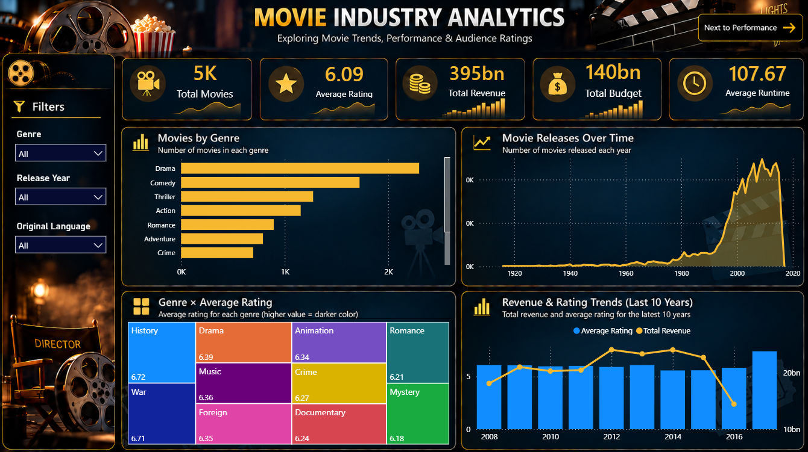
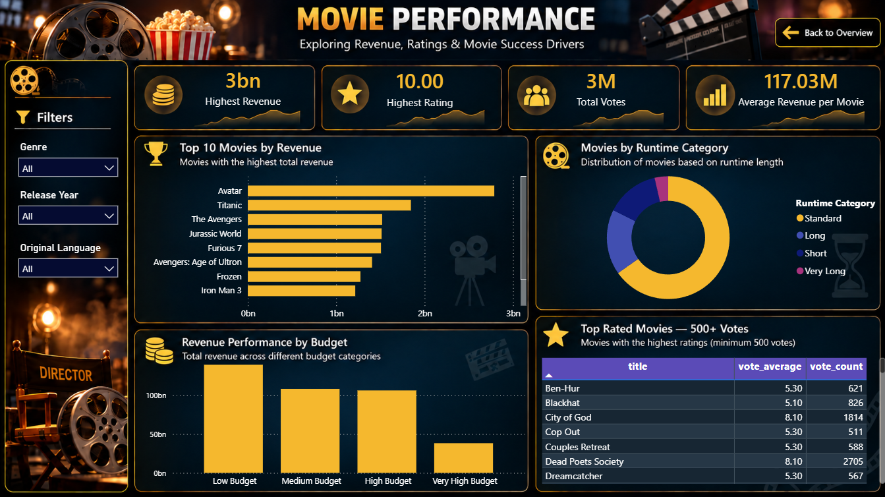

# 🎬 Movie Analytics Dashboard

An interactive **Power BI Movie Analytics Dashboard** built using the TMDB 5000 Movies dataset.

## 📊 Dashboard Preview

### Movie Overview

### Movie Performance

## 🎯 Project Objectives

This project analyzes:

- 🎬 Movie releases and number of movies over the years
- 🎭 Movie distribution across genres
- ⭐ Average movie ratings
- 💰 Movie budgets and revenues
- 🏆 Highest-revenue movies
- ⭐ Highest-rated movies considering vote count
- 📈 Revenue and rating trends over time
- ⏱️ Movie runtime and performance
- 📊 Key insights from movie data

## 🛠️ Tools & Technologies

- Power BI
- Power Query
- DAX
- Excel / CSV
- Data Analysis
- Data Visualization

## 📁 Dataset

The project uses the **TMDB 5000 Movies Dataset**.

Main fields include:

- Budget
- Revenue
- Genres
- Release Date
- Runtime
- Popularity
- Vote Average
- Vote Count
- Original Language

## 📌 Dashboard Pages

### 1. Movie Overview

The overview page provides:

- Total Movies
- Average Rating
- Total Revenue
- Total Budget
- Average Runtime
- Movie Releases Over Time
- Revenue & Rating Trends
- Movies by Genre
- Interactive filters

### 2. Movie Performance

The performance page focuses on:

- Highest Revenue
- Highest Rating
- Total Votes
- Average Revenue per Movie
- Top 10 Movies by Revenue
- Top Rated Movies with 500+ Votes
- Revenue Performance by Budget Category
- Movies by Runtime Category

## 🔍 Key Insights

The dashboard helps identify:

- The highest-revenue movies
- Movie release trends over time
- The most common movie genres
- Rating patterns across movies
- Revenue performance across budget categories
- Runtime distribution
- Highly rated movies with a strong number of audience votes

## 🧮 Data Preparation

Power Query was used for:

- Correcting data types
- Creating the **Release Year** field
- Extracting genres from JSON data
- Creating the **Movie Genres** table
- Removing invalid/error rows
- Creating relationships between movie and genre data

DAX was used to create measures and calculated categories for the analysis.

## 📐 Data Model

Main tables:

- **Movies**
- **Movie Genres**

Relationship:

`Movies[id]` → `Movie Genres[id]`

## 📂 Project Files

- `Movies_Analysis_Dashbord.pbix`
- `tmdb_5000_movies.csv`
- `Moviev_Overview.png`
- `Movie_Performance.png`
- `README.md`

## 👨‍💻 Author

**Youssef Ashraf**

Computer & Information Technology Student  
Egyptian E-Learning University (EELU)

---

⭐ If you find this project useful, feel free to give the repository a star!
