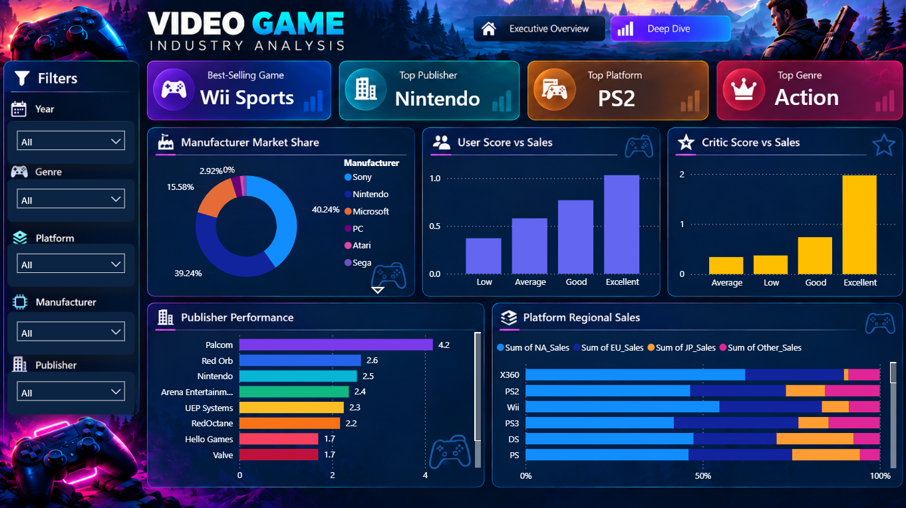
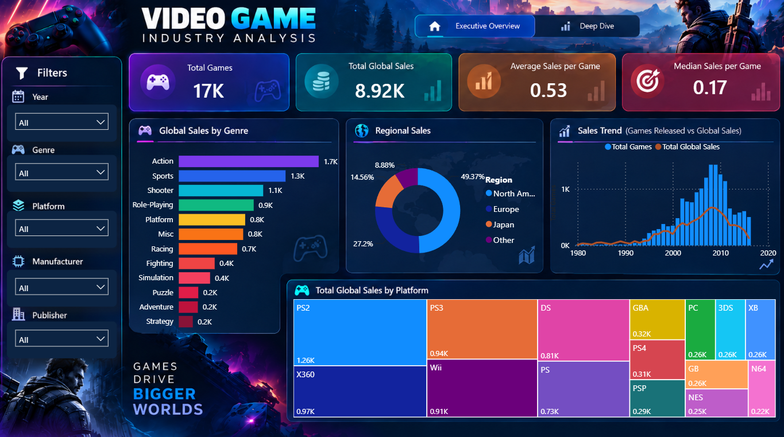

# 🎮 Task 11 — Video Game Industry Analysis

**VOLTIX Internship | Python • EDA • Power BI**

## 📌 Project Overview
This project analyzes video game sales across games, genres, platforms, publishers, manufacturers, release years, and regions. It combines Python-based data cleaning and exploratory data analysis (EDA) with an interactive Power BI dashboard.

## 🖥️ Power BI Dashboard Preview

### 1. Executive Overview


This page provides a high-level view of the industry through key performance indicators, genre sales, regional sales, yearly trends, and platform performance.

### 2. Deep Dive


This page explores manufacturer market share, rating categories versus sales, publisher performance, and the regional sales mix across platforms.

> **Important:** Keep `Executive_Overview.png` and `Deep_Dive.png` in the same folder as this `README.md` file so the images display correctly on GitHub.

## 🎯 Objectives
- Analyze global sales and release trends.
- Compare sales across genres and platforms.
- Identify leading games and publishers.
- Explore regional sales distribution.
- Examine the relationship between ratings and sales.
- Present findings through interactive visualizations and business recommendations.

## 🛠️ Tools & Technologies
- **Python** — data cleaning and exploratory analysis
- **Pandas & NumPy** — data manipulation
- **Matplotlib & Seaborn** — data visualization
- **Power BI** — interactive dashboard
- **DAX** — measures and regional-sales calculations
- **Jupyter Notebook** — analysis workflow

## 🧹 Data Cleaning
The dataset was reviewed and cleaned before analysis. Key steps included:
- Reviewing data types and missing values.
- Checking for duplicate records.
- Checking sales columns for invalid negative values.
- Avoiding fabricated values for missing rating scores.
- Creating a derived `Manufacturer` column based on the gaming platform.
- Exporting the cleaned dataset as `Video_Games_Cleaned.csv`.

Missing ratings and release years were retained where appropriate and excluded only from analyses that require those values.

## 📊 Exploratory Data Analysis
The analysis covered:
- **Genre Analysis:** game counts, total global sales, and average sales per game.
- **Platform Analysis:** leading platforms by total and average sales.
- **Publisher Analysis:** total sales and average sales per game, using a minimum game-count threshold for fairer comparisons.
- **Top-Selling Games:** ranking games by global sales.
- **Sales Trends:** annual releases and global sales over time.
- **Regional Analysis:** sales in North America, Europe, Japan, and other regions.
- **Ratings Analysis:** comparing critic/user scores with global sales.
- **Manufacturer Analysis:** comparing sales across platform manufacturers.

## 💡 Key Insights
- **Action** led genres by total global sales, at approximately **1,745.26 million units**.
- **PS2** led platforms by total global sales, at approximately **1,255.64 million units**.
- **Nintendo** led publishers by total global sales, at approximately **1,788.81 million units**.
- **Wii Sports** was the best-selling game, with approximately **82.53 million units**.
- **North America** represented the largest regional share, at approximately **49.37%** of recorded global sales.
- Global sales peaked in **2008**, at approximately **671.79 million units**.
- Critic scores had a stronger positive correlation with global sales (**0.245**) than user scores (**0.088**). Correlation does not establish causation.

*Sales figures are expressed in millions of units, as provided by the dataset.*

## 📈 Dashboard Contents

### Executive Overview
- Total Games, Total Global Sales, Average Sales per Game, and Median Sales per Game
- Global Sales by Genre
- Regional Sales
- Sales Trend
- Global Sales by Platform

### Deep Dive
- Best-Selling Game, Top Publisher, Top Platform, and Top Genre
- Manufacturer Market Share
- User Score vs Sales
- Critic Score vs Sales
- Publisher Performance
- Platform Regional Sales

Both pages include slicers for **Year, Genre, Platform, Manufacturer, and Publisher**.

## 🧠 Business Recommendations
- Consider both total demand and average sales per game when evaluating genres and platforms.
- Tailor marketing strategies to regional sales differences.
- Use publisher and platform performance as benchmarks, accounting for the number of games in each group.
- Treat ratings as one signal among several; this analysis shows association, not proof that ratings cause sales.
- Consider release timing, platform audience, genre preferences, and regional demand when planning game launches.

## 📁 Project Files
```text
Task_11_Video_Game_Industry_Analysis/
├── Executive_Overview.png
├── Deep_Dive.png
├── Video_Games_Dashboard.pbix
├── Video_Game_EDA.ipynb
├── Video_Games_Cleaned.csv
├── Video_Games_Sales_as_at_22_Dec_2016.csv
└── README.md
```

*If the original dataset has a different filename, update the entry above to match the actual file in your folder.*

## ▶️ How to Use
1. Open `Video_Game_EDA.ipynb` to review the data cleaning and EDA workflow.
2. Open `Video_Games_Dashboard.pbix` in Power BI Desktop.
3. Use the slicers to filter by year, genre, platform, manufacturer, and publisher.

## 🙌 Acknowledgment
This project was completed as part of the **VOLTIX Internship**, focusing on practical skills in data cleaning, exploratory analysis, data visualization, and business intelligence.
