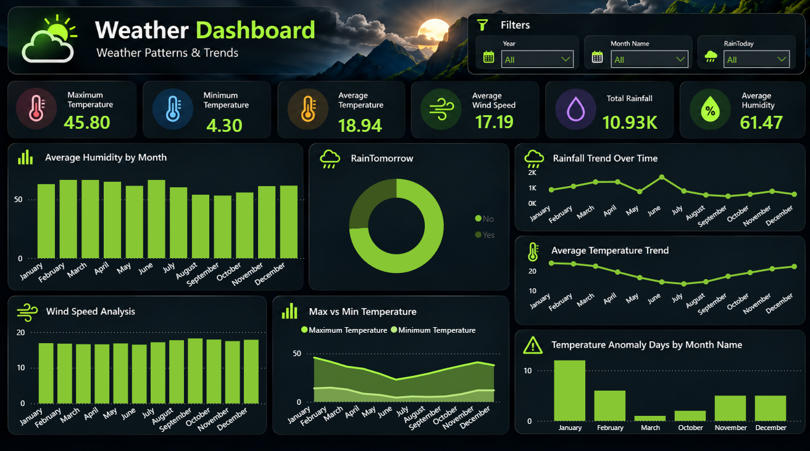

# 🌦️ Weather Insights Dashboard \| Power BI

An interactive Power BI dashboard for exploring historical weather
patterns, tracking key weather indicators, and identifying unusual
temperature days.

## 📊 Dashboard Preview

## 🎯 Project Objective

The goal of this project is to analyze historical weather data and
present useful insights about temperature, humidity, wind speed, and
rainfall through an interactive Power BI dashboard.

## 🧰 Tools & Technologies

-   **Power BI** --- data modeling, DAX measures, interactive visuals,
    and dashboard design
-   **Power Query** --- data preparation and data quality checks
-   **DAX** --- KPI calculations and temperature anomaly detection
-   **CSV** --- source dataset format

## 📁 Project Files

  -----------------------------------------------------------------------
  File                                Description
  ----------------------------------- -----------------------------------
  `Weather Insights Dashboard.pbix`   Power BI report containing the
                                      dashboard and data model

  `Weather_Dashboard.png`             Dashboard preview image

  `Weather_Data.csv`                  Weather dataset used for the
                                      analysis
  -----------------------------------------------------------------------

## 📌 Dashboard Highlights

### KPI Cards

-   Average Temperature
-   Maximum Temperature
-   Minimum Temperature
-   Average Humidity
-   Average Wind Speed
-   Total Rainfall

### Visualizations

-   **Average Humidity by Month** --- compares monthly average humidity.
-   **RainTomorrow** --- shows the distribution of records where rain is
    or is not expected tomorrow.
-   **Rainfall Trend Over Time** --- tracks rainfall across the months.
-   **Average Temperature Trend** --- highlights changes in average
    temperature throughout the year.
-   **Wind Speed Analysis** --- compares average wind speed by month.
-   **Max vs Min Temperature** --- compares average maximum and minimum
    temperatures by month.
-   **Temperature Anomaly Days by Month** --- shows the monthly
    distribution of days flagged as unusual based on the IQR method.

## 🔎 Data Preparation & Analysis

-   Reviewed data quality using Power Query.
-   Created a separate Calendar table for date-based analysis.
-   Connected `Calendar[Date]` to `Weather_Data[Date]`.
-   Created DAX measures for key weather indicators.
-   Used the Interquartile Range (IQR) method to flag unusually high or
    low maximum temperatures.
-   Added slicers for **Year**, **Month Name**, and **RainToday** to
    make the report interactive.

## 💡 Key Analytical Focus

This dashboard helps users explore: - How average temperatures vary
throughout the year. - How humidity and wind speed change by month. -
How rainfall varies over time. - The distribution of `RainTomorrow`
values in the dataset. - Which months contain days flagged as
temperature anomalies.

> **Note:** An anomaly is a statistical flag based on the IQR rule; it
> does not automatically mean that a weather observation is erroneous.

## 🚀 How to Use

1.  Download or clone this repository.
2.  Keep `Weather_Dashboard.png` and `Weather_Data.csv` in the project
    folder.
3.  Open `Weather Insights Dashboard.pbix` in Power BI Desktop.
4.  If Power BI asks for the source file location, point it to
    `Weather_Data.csv` and refresh the data.
5.  Use the Year, Month Name, and RainToday slicers to explore the
    report.

## 🎨 Dashboard Design

The dashboard uses a dark theme with neon-green accents, weather-related
icons, KPI cards, and grouped charts to keep the most important
information easy to scan.

------------------------------------------------------------------------

**Project:** Weather Insights Dashboard\
**Category:** Data Analysis & Visualization\
**Tool:** Microsoft Power BI
