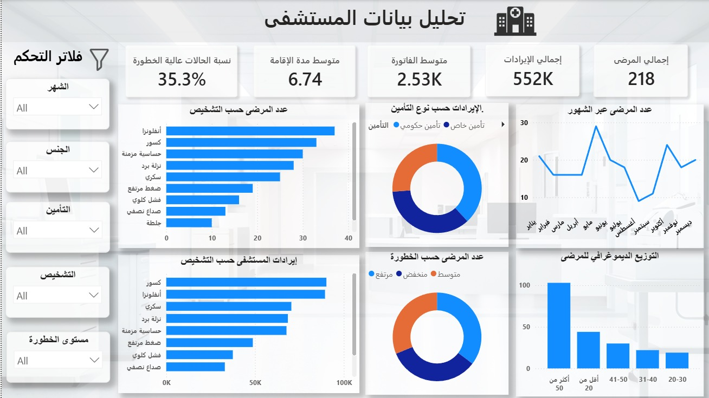

# 🏥 Hospital Analytics Dashboard

## 📌 Overview

This project was developed as **Task 7** during my **Voltix Internship**.

The project focuses on analyzing hospital data and transforming raw data into meaningful **KPIs, insights, and an interactive Power BI dashboard**.

---

## 🔄 Project Workflow

**Raw Data → Data Cleaning → Data Modeling → DAX Measures → Analysis → Dashboard → Insights**

---

## 🧹 Data Cleaning

Data cleaning and transformation were performed using **Power Query**, including:

- Handling missing values.
- Removing duplicate records.
- Correcting data types.
- Validating patient data.
- Handling inconsistent gender data.
- Detecting invalid admission and discharge dates.
- Creating the **Length of Stay** column.
- Performing final data quality checks.

---

## 📊 KPIs

The dashboard includes several important KPIs:

- **Total Patients:** 218
- **Total Revenue:** 551,740
- **Average Bill:** 2.53K
- **Average Length of Stay:** 6.74 Days
- **High-Risk Patients:** 35.3%

---

## 📈 Dashboard

The interactive dashboard provides analysis of:

- Patients by Diagnosis
- Revenue by Diagnosis
- Patients by Risk Level
- Revenue by Insurance Type
- Patient Age Distribution
- Monthly Patient Trends
- Interactive filtering by Gender, Insurance, Diagnosis, Risk Level, and Month

---

## 🔍 Key Insights

- High-risk patients represent **35.3%** of the total patients.
- **Influenza** is the most frequent diagnosis.
- **Fractures** generated the highest revenue among diagnoses.
- The average patient bill is approximately **2.53K**.
- The average length of stay is **6.74 days**.
- Patient volume shows noticeable variation across months.

---

## 🛠️ Tools & Technologies

- **Power BI**
- **Power Query**
- **DAX**
- **Microsoft Excel**

---

## 🔗 Power BI Dashboard

[View Interactive Dashboard](https://app.powerbi.com/groups/me/reports/4d2ef4b2-8a8d-4988-9320-64e112141237?ctid=f00f2f39-2ff1-431f-aba9-3273f8ad190e&pbi_source=linkShare)

---

## 🎯 Project Objective

The main objective of this project is to transform raw hospital data into meaningful information and actionable insights through data cleaning, analysis, visualization, and interactive reporting.

---

## 👤 Author

**Youssef Ashraf**

Data Analysis | Power BI | Python | SQL
