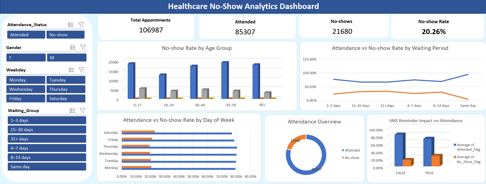

# Healthcare No-Show Analytics Dashboard

An interactive Excel dashboard analyzing patient appointment attendance
and patterns associated with missed appointments (*no-shows*).

## Dashboard Preview

## Project Files

-   **`healthcare_Dahbord.xlsx`** --- the Excel workbook containing the
    dashboard and analysis.
-   **`healthcare_Dahbord.png`** --- dashboard preview image displayed
    above.
-   **`healthcare_noshows.csv`** --- source dataset used for the
    analysis.
-   **`README.md`** --- project documentation.

> Keep these files in the same GitHub repository folder so the dashboard
> image renders correctly.

## Project Overview

The goal of this project was to transform the raw Healthcare No-Shows
dataset into a clear, interactive Excel dashboard that helps explore
appointment attendance and factors associated with no-shows.

## Key Performance Indicators (KPIs)

-   **Total Appointments:** 106,987
-   **Attended Appointments:** 85,307
-   **No-show Appointments:** 21,680
-   **Overall No-show Rate:** 20.26%

## Data Preparation

The dataset was reviewed and prepared before analysis. Preparation
included checking data types and consistency, creating age and
waiting-period groups, and creating binary flags for attendance
outcomes. The `No_Show_Flag` field represents a no-show as `1` and an
attended appointment as `0`; its average gives the no-show rate.

## Dashboard Features

-   **Attendance Overview:** Donut chart comparing attended appointments
    with no-shows.
-   **No-show Rate by Age Group:** Compares no-show rates across age
    categories.
-   **Attendance vs No-show Rate by Waiting Period:** Compares
    attendance and no-show rates across waiting-period groups.
-   **Attendance vs No-show Rate by Day of Week:** Compares both rates
    across weekdays.
-   **SMS Reminder Impact on Attendance:** Compares attendance and
    no-show rates for appointments with and without SMS reminders.
-   **Interactive Slicers:** Filter the dashboard by attendance status,
    gender, weekday, and waiting-period group.

## Key Insights

-   The dataset contains **106,987 appointments**, including **85,307
    attended appointments** and **21,680 no-shows**.
-   The overall no-show rate is **20.26%**.
-   The no-show rate rises across waiting-period groups in this dataset,
    from **4.69% for same-day appointments** to **33.16% for waiting
    periods of 31+ days**.
-   The **18--29 age group** has the highest no-show rate among the
    displayed age groups (**24.65%**).
-   The no-show rate is **27.67% for appointments with an SMS reminder**
    and **16.73% for appointments without one**. This is an observed
    association and does not prove that SMS reminders cause more
    no-shows.
-   Saturday has far fewer appointments than the other days, so its rate
    should be interpreted cautiously.

## Tools Used

-   Microsoft Excel
-   Power Query
-   PivotTables and PivotCharts
-   Excel formulas and calculated flags
-   Slicers for interactive filtering

## How to Use

1.  Open `healthcare_Dahbord.xlsx` in Microsoft Excel.
2.  Navigate to the **Healthcare Dashboard** sheet.
3.  Use the slicers on the left to filter the charts and explore
    patterns.
4.  Review the KPI cards and charts to compare attendance outcomes.
5.  If the source data changes, refresh the relevant queries and
    PivotTables.

## Notes

This dashboard supports descriptive analysis. Observed differences
between groups identify patterns in the dataset and should not be
interpreted as proof of causation.
