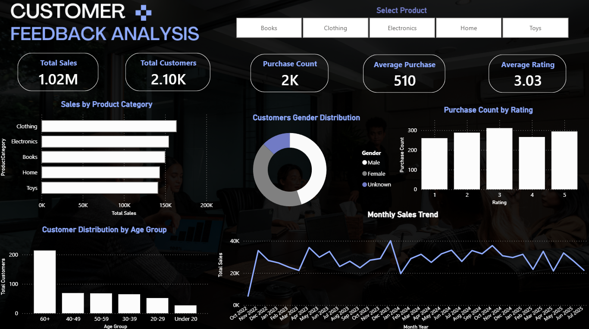

# 📊 Customer Data Analysis --- Voltix Internship \| Task 9

## 📌 Project Overview

This project was completed as **Task 9 of the Voltix Internship**.

The goal was to clean and analyze customer data, identify meaningful
patterns and insights, and build an interactive **Power BI dashboard**.

## 🎯 Objectives

-   Clean and prepare the customer dataset
-   Handle missing and invalid values
-   Analyze customer demographics such as Age and Gender
-   Analyze Purchase Amount and sales performance
-   Analyze Product Categories
-   Analyze customer Ratings
-   Explore sales trends over time
-   Extract Business Insights
-   Build an interactive Power BI Dashboard

## 🛠️ Tools & Technologies

-   Python
-   Pandas
-   NumPy
-   Google Colab / Jupyter Notebook
-   Power BI
-   Power Query
-   DAX

## 🔍 Data Cleaning

The dataset contained duplicate records, missing values, inconsistent
Gender values, invalid Age values, invalid Ratings, invalid Purchase
Dates, and missing Product Categories.

The data was cleaned while avoiding unnecessary imputation that could
distort the analysis.

## 📈 Key Insights

-   **Total Sales:** 1.02M
-   **Average Purchase:** 509.90
-   **Highest-selling known category:** Clothing
-   **Average Rating:** 3.03 / 5
-   Male and Female customers had relatively similar distributions.
-   The available sales data covers **October 2022 to July 2025**.

> Age-based findings should be interpreted carefully because a large
> percentage of Age values were missing or invalid.

## 📊 Power BI Dashboard

The dashboard includes:

-   Total Sales
-   Total Customers
-   Purchase Count
-   Average Purchase
-   Average Rating
-   Sales by Product Category
-   Customer Gender Distribution
-   Customer Rating Distribution
-   Customer Distribution by Age Group
-   Monthly Sales Trend

### Dashboard Preview



## 📁 Project Files

  ------------------------------------------------------------------------------------
  File                                             Description
  ------------------------------------------------ -----------------------------------
  `Customer_EDA.ipynb`                             Python EDA and data cleaning

  `Customers_Fakedata.csv`                         Original dataset

  `Customers_Cleaned.csv`                          Cleaned dataset

  `Customer_Analysis_Dashboard.pbix`               Power BI dashboard

  `Customer_Dashbord.png`                          Dashboard preview

  `Customer_Data_Analysis_Business_Insights.pdf`   Business Insights and Executive
                                                   Summary
  ------------------------------------------------------------------------------------

## 🚀 Project Workflow

``` text
Raw Customer Dataset
        ↓
Data Understanding
        ↓
Data Cleaning with Python
        ↓
Exploratory Data Analysis
        ↓
Cleaned Dataset
        ↓
Power BI
        ↓
DAX Measures & Visualizations
        ↓
Interactive Dashboard
        ↓
Business Insights
```

## 👨‍💻 Author

**Youssef Ashraf**

Data Analysis \| Python \| SQL \| Power BI \| Excel \| Machine Learning

## 📌 Internship

**Voltix Internship --- Task 9**

Customer Data Analysis & Dashboard
